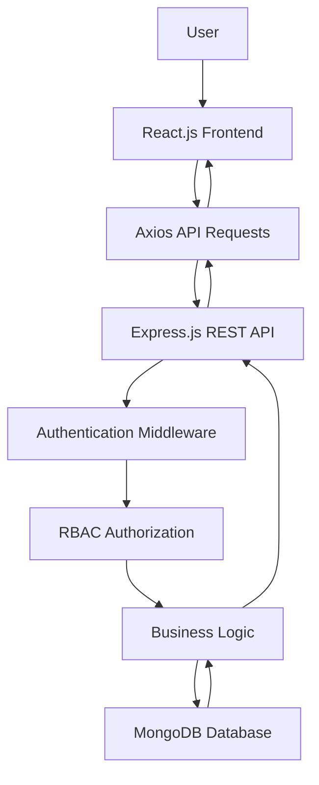

# 📚 BookBadli — Book Rental Web App

**Read More. Spend Less. Share Stories.**

BookBadli is a full-stack web application designed to make books more accessible through a book rental platform. It enables users to explore books and facilitates book rental management through a modern frontend and a RESTful backend.

Built using the **MERN stack**, the project focuses on secure authentication, role-based authorization, efficient state management, and seamless frontend-backend communication.

## ✨ Features

- 📖 **Book Browsing:** Explore available books and discover your next read.
- 🔐 **Secure Authentication:** JWT-based authentication using HTTP-only cookies.
- 🛡️ **Role-Based Access Control (RBAC):** Middleware-based authorization to restrict access according to user roles.
- 🔄 **RESTful APIs:** Backend endpoints for application and book-related operations.
- ⚡ **State Management:** Redux Toolkit and React Context API for managing application state.
- 🌐 **API Integration:** Axios for communicating with backend services.
- 🗄️ **Database Management:** MongoDB for storing application data.
- 📱 **Component-Based UI:** React.js for building reusable and maintainable interface components.

## 🛠️ Tech Stack

| Technology | Purpose |
|---|---|
| React.js | Frontend development |
| Node.js | Server-side runtime |
| Express.js | Backend framework and REST APIs |
| MongoDB | NoSQL database |
| JWT | Authentication |
| HTTP-only Cookies | Secure token storage |
| Middleware | Authentication and role-based authorization |
| Redux Toolkit | Application state management |
| React Context API | Shared state management |
| Axios | HTTP requests and API integration |
| Git & GitHub | Version control |

## 🏗️ Architecture

BookBadli follows a client-server architecture in which the React frontend communicates with the Express.js backend through REST APIs, while MongoDB stores application data.



## 🔐 Authentication & Authorization

Security is an important part of BookBadli.

- **JWT Authentication:** Uses JSON Web Tokens to authenticate users.
- **HTTP-only Cookies:** Stores authentication tokens in cookies inaccessible to client-side JavaScript.
- **Authentication Middleware:** Validates requests before granting access to protected routes.
- **Role-Based Access Control:** Restricts protected operations based on assigned user roles.

These mechanisms help protect private routes and prevent unauthorized access to restricted operations.

## 📂 Project Structure

The following is a suggested structure; update it to match your repository.

```text
BookBadli/
│
├── client/
│   ├── public/
│   └── src/
│       ├── components/
│       ├── pages/
│       ├── context/
│       ├── redux/
│       ├── services/
│       └── App.jsx
│
├── server/
│   ├── controllers/
│   ├── middleware/
│   ├── models/
│   ├── routes/
│   ├── config/
│   └── server.js
│
├── .gitignore
└── README.md
```

## ⚙️ Getting Started

### Prerequisites

Ensure you have installed:

- Node.js and npm
- MongoDB or a MongoDB Atlas account
- Git

### 1. Clone the Repository

```bash
git clone https://github.com/YOUR-USERNAME/BookBadli.git
cd BookBadli
```

### 2. Set Up the Backend

Navigate to the backend directory:

```bash
cd server
npm install
```

Create a `.env` file in the backend directory:

```env
PORT=5000
MONGODB_URI=your_mongodb_connection_string
JWT_SECRET=your_secure_secret
CLIENT_URL=http://localhost:5173
```

Use the environment variable names expected by your actual application. Never commit real credentials or secrets.

Start the backend:

```bash
npm run dev
```

### 3. Set Up the Frontend

Open a separate terminal:

```bash
cd client
npm install
npm run dev
```

### 4. Open the Application

Visit the local URL printed by your frontend development server, commonly:

```text
http://localhost:5173
```

*Note: These commands assume a separate `client` and `server` setup with matching npm scripts. Adjust them according to your actual project configuration.*

## 🔄 Application Workflow

1. The user interacts with the React.js frontend.
2. Axios sends requests to the Express.js backend.
3. Authentication middleware validates the user's identity when required.
4. RBAC middleware checks permissions for restricted operations.
5. The backend processes requests and interacts with MongoDB.
6. The server returns a response to the frontend, where the UI and application state are updated.

## 🧠 Key Learnings

- Developed a full-stack application using React.js, Node.js, Express.js, and MongoDB.
- Implemented JWT-based authentication with HTTP-only cookies.
- Designed middleware for authentication and role-based authorization.
- Built and integrated RESTful APIs.
- Managed frontend state using Redux Toolkit and React Context API.
- Integrated backend APIs using Axios.
- Applied modular coding practices for maintainability and scalability.

## 🚀 Future Enhancements

- Add book recommendations based on reading preferences.
- Implement book search, category filters, and sorting.
- Introduce rental duration tracking and due-date reminders.
- Add book availability management and rental history.
- Integrate online payments and automated rental receipts.
- Deploy the application for public access.

## 👩‍💻 Author

**Anadi Chouhan**

B.Tech CSE — Artificial Intelligence & Machine Learning

---

⭐ If you like this project, consider giving the repository a star!

